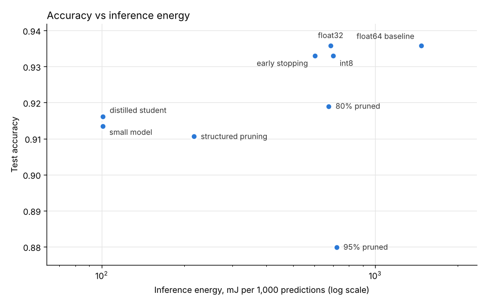

# Green AI for Software Engineering

**A systematic survey of energy-efficient techniques for AI-driven code generation and maintenance, plus a small hands-on benchmark that measures them.**

AI coding tools like Copilot, CodeBERT and CodeT5 are now part of normal development, but the models behind them use a lot of energy. Training them is expensive, and because a code assistant gets queried millions of times, inference can end up costing even more. For my Intelligent Software Engineering module I wrote a survey of the techniques that reduce that cost and the trade-offs each one makes.

📄 **Paper:** [`paper/green-ai-for-se-survey.pdf`](paper/green-ai-for-se-survey.pdf)

The paper is a literature review with no code of its own, so I also built this repo to put the ideas into practice. It applies each technique to the same model on a real software-engineering task and measures what changes: energy, accuracy, model size and FLOPs.

## The survey in short

I followed Kitchenham & Charters' systematic literature review process. That started with about 60 papers from IEEE Xplore, ACM DL, SpringerLink and Google Scholar, narrowed to about 30 after screening and then to **12 core papers**. The techniques fall into four groups, each acting on a different stage of the AI lifecycle:

| Lifecycle stage | Category | Techniques |
|---|---|---|
| Model design | **Efficient architectures** | sparse attention (Longformer), code-specific pre-training (CodeBERT, CodeT5) |
| Training | **Energy-aware training** | mixed precision, early stopping, adaptive LR schedules, LoRA |
| Deployment | **Model optimisation** | pruning, quantisation, knowledge distillation |
| Infrastructure | **Infrastructure optimisation** | efficient accelerators, carbon-aware scheduling |

The main conclusion is that **no single technique is enough**. The right choice depends on whether your cost is mostly training (frequent retraining or adaptation to new repos) or mostly serving (real-time completion in an IDE). The best results come from combining efficient models, efficient adaptation and efficient infrastructure.

## The code: measuring the trade-offs

### Task

The task is to **predict which standard-library component a Python function belongs to** (asyncio, email, http, xml or unittest), using only its source code. It works as a small version of the component-routing, bug-triage and code-search problems that real SE tools solve. The dataset is built from the Python install on your machine, so there's nothing to download: about 2,400 functions, turned into hashed bag-of-identifier features with camelCase and snake_case split up.

The model is a plain multi-layer perceptron (2048 → 512 → 256 → 5) that I wrote from scratch in NumPy. I did that so each technique fits in a few readable lines: pruning is a mask, quantisation is a rescale-and-round, and LoRA is two extra matrices. Gradients, including the distillation and LoRA paths, are checked against finite differences in the tests.

### Results

From one full run on a 2-vCPU Linux VM (`python run_experiments.py`). The full table is in [`results/results.md`](results/results.md).

| Technique | Accuracy | Training energy | Inference energy (per 1k) | Size | What changed |
|---|---|---|---|---|---|
| Baseline: float64, 40 fixed epochs | 0.936 | 961 J | 1471 mJ | 9.0 MB | - |
| float32 | 0.936 | 478 J | 687 mJ | 4.5 MB | **−50% training energy, same accuracy** |
| float32 + early stopping | 0.933 | 81 J | 601 mJ | 4.5 MB | stopped at epoch 7, **−92% vs baseline** |
| Unstructured pruning 80% | 0.919 | +35 J | 676 mJ | 1.8 MB* | −80% FLOPs on paper, but **no real speed-up** |
| Structured pruning (keep 25%) | 0.911 | +17 J | 217 mJ | 1.0 MB | **−64% inference energy** |
| int8 weight quantisation | 0.933 | 0 | 700 mJ | 1.1 MB | **−75% size, no accuracy loss** |
| Small model (2048→64→5) | 0.913 | 20 J | 101 mJ | 0.5 MB | −83% inference energy |
| ↳ same, distilled from the big one | 0.916 | 34 J | 101 mJ | 0.5 MB | +0.3 pts from distillation |
| Adapt to new task: full fine-tune | 0.936 | 52 J | - | - | 1.18M trainable params |
| Adapt to new task: **LoRA rank 8** | **0.941** | **19 J** | - | - | **2.3% of the params, −63% energy** |

<sub>* size if the sparse matrices were stored in CSR format.</sub>

<p align="center"></p>

**What I took from running it:**

1. **The cheapest wins are in training.** Dropping from float64 to float32 halved the energy for free, and early stopping removed most of what was left. In the paper I called these "low-effort interventions", and they really are only a couple of lines of code.
2. **Unstructured pruning only saves energy if your hardware can use it.** Removing 80% of the weights cuts FLOPs by 80%, but a dense matrix multiply still processes every zero, so energy didn't drop at all. Structured pruning removes whole neurons, so the matrices actually get smaller and the saving shows up. That matches the paper's warning that efficiency gains depend on hardware support.
3. **Quantisation is mostly a memory and size win on a CPU.** It was 4× smaller with identical accuracy. Without int8 kernels the arithmetic itself isn't faster, and a GPU or NPU is where you'd see the speed-up.
4. **For serving, a smaller model beats squeezing a big one.** The 64-unit student uses about 6× less inference energy than the full model for a 2-point accuracy drop. Distillation only helped a little on this easy task. On harder tasks with more classes there's more "dark knowledge" for the student to pick up.
5. **LoRA is the clear choice for repeated adaptation.** It trains 2.3% of the parameters with 63% less energy and was slightly *more* accurate, probably because freezing the base weights acts as a regulariser. This is the scenario the paper highlights: adapting one base model to many repositories.
6. **Carbon-aware scheduling is a big lever that needs no ML changes.** Shifting the same training job from 17:00 to 03:00 on an example UK-shaped grid profile cut its emissions by about 52%.

### How energy is measured

On Linux machines with readable Intel/AMD RAPL counters, `EnergyTracker` reads real CPU package energy. Elsewhere, including the VM I used for the results above, it **estimates** energy as `CPU seconds × (TDP ÷ cores)`. That's fine for *comparing* techniques on the same machine, but it isn't an absolute wattage. The paper's evaluation section argues that every study should report how energy was measured, so it's stated here, and every row in `results.json` records its method. You can set your own CPU's TDP and your grid's carbon intensity:

```bash
GREENAI_TDP_WATTS=28 GREENAI_GRID_INTENSITY=150 python run_experiments.py
```

The grid profile in `greenai/carbon.py` is illustrative. For real decisions, load a forecast from your grid operator (for example the GB Carbon Intensity API) with `carbon.load_profile()`.

## Running it

```bash
git clone https://github.com/emmanuelthecode/green-ai-for-software-engineering.git
cd green-ai-for-software-engineering
pip install -r requirements.txt

python run_experiments.py --quick   # ~20s
python run_experiments.py           # ~1.5 min, the full results above
python -m pytest                    # gradient checks + technique tests
```

Only NumPy and Matplotlib are needed.

```
greenai/
  data.py       builds the code-classification dataset from the stdlib
  mlp.py        NumPy MLP: Adam, early stopping, distillation loss, LoRA adapters
  compress.py   unstructured / structured pruning, int8 quantisation
  energy.py     RAPL-or-estimate energy tracker, CO2e conversion
  carbon.py     carbon-aware scheduling
paper/          the survey (PDF)
results/        output of the last full run
run_experiments.py
```

## Mapping paper → code

| Paper section | Technique | Where |
|---|---|---|
| 4.1 | Pruning (unstructured + structured) | `compress.magnitude_prune`, `compress.structured_prune` |
| 4.2 | Quantisation | `compress.QuantisedMLP` |
| 4.3 | Knowledge distillation | `mlp.MLP.gradients(teacher_probs=...)` |
| 4.6 | Mixed / reduced precision | `MLP(dtype=np.float32)` vs `float64` |
| 4.7 | Early stopping | `mlp.train(val=..., patience=...)` |
| 4.8 | Parameter-efficient fine-tuning (LoRA) | `mlp.MLP.add_lora` |
| 4.9 | Carbon-aware scheduling | `carbon.best_window`, `carbon.compare` |
| 6.1–6.2 | Energy, CO2e, FLOPs, latency metrics | `energy.EnergyTracker`, `MLP.flops_per_sample` |

Sparse attention and code-specific pre-training (4.4, 4.5) need transformer-scale models, so I've left them out of a CPU-only demo.

## Limitations

- It's a small MLP on a small dataset, so the absolute numbers say nothing about a 7B-parameter code model. The *direction* of each trade-off is what transfers.
- Energy is estimated on machines without RAPL (see above).
- Inference timings are a single measurement over 100k predictions and can vary by ±10% between runs.

## Key references

Strubell et al. (2019) *Energy and Policy Considerations for Deep Learning in NLP* · Schwartz et al. (2020) *Green AI* · Han et al. (2016) *Deep Compression* · Hinton et al. (2015) *Distilling the Knowledge in a Neural Network* · Micikevicius et al. (2018) *Mixed Precision Training* · Hu et al. (2021) *LoRA* · Patterson et al. (2021) *Carbon Emissions and Large Neural Network Training* · Luccioni et al. (2024) *Power Hungry Processing*. The full list is in the paper.
